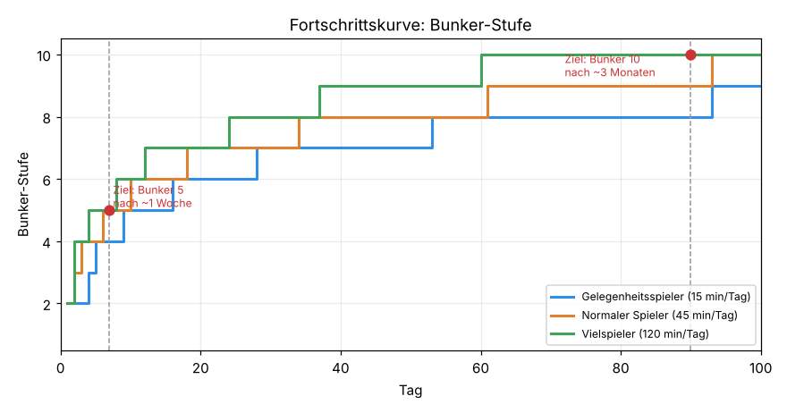
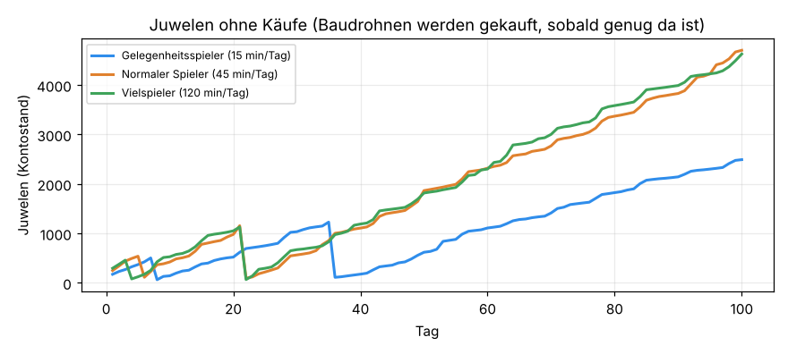
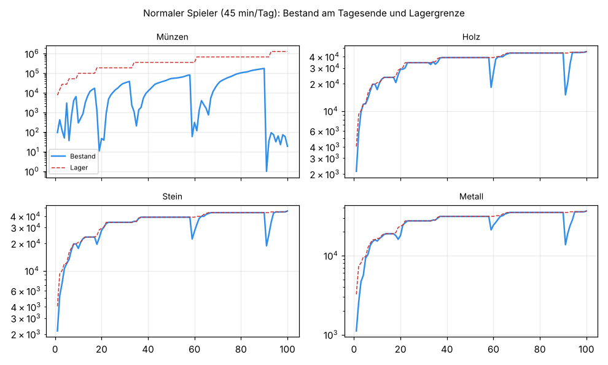

# Wirtschaftssimulation (Paket Q)

Erzeugt von `tools/wirtschaft_sim.py` aus den Zahlen des Spiels (`--autotest=econ_dump` → `docs/balance/wirtschaft_daten.json`)
und der gemessenen Expeditions-Beute (`docs/balance/expedition_beute.json`, Expeditions-Bot je Gebiet). Neu erzeugen:

```
godot --headless -- --autotest=econ_dump
python3 tools/wirtschaft_sim.py
```

Gerechnet werden 100 Tage für drei Spielertypen. Ziel (Kapitel 12.2): **Bunker 5 nach etwa 1 Woche, Bunker 10 nach etwa 3 Monaten**.

## Fortschritt: Tag, an dem die Bunker-Stufe erreicht ist

| Spieler | B2 | B3 | B4 | B5 | B6 | B7 | B8 | B9 | B10 |
|---|---|---|---|---|---|---|---|---|---|
| Gelegenheitsspieler (15 min/Tag) | 1.0 | 3.2 | 5.0 | 8.6 | 15.6 | 28.0 | 52.1 | 92.1 | – |
| Normaler Spieler (45 min/Tag) | 0.4 | 1.1 | 2.4 | 5.4 | 10.0 | 18.0 | 33.1 | 60.1 | 92.7 |
| Vielspieler (120 min/Tag) | 0.1 | 1.1 | 2.0 | 3.5 | 7.1 | 12.0 | 23.1 | 36.5 | 60.0 |

Zum Vergleich **vor** den Anpassungen dieses Pakets (gleiche Simulation, alte Zahlen):

| Spieler | B2 | B3 | B4 | B5 | B6 | B7 | B8 | B9 | B10 |
|---|---|---|---|---|---|---|---|---|---|
| Gelegenheitsspieler (15 min/Tag) | 1.0 | 3.2 | 5.0 | 7.6 | 15.6 | 28.0 | 52.1 | – | – |
| Normaler Spieler (45 min/Tag) | 0.4 | 1.1 | 2.4 | 5.4 | 10.0 | 18.0 | 33.1 | – | – |
| Vielspieler (120 min/Tag) | 0.1 | 1.1 | 2.0 | 3.5 | 7.1 | 12.0 | 23.1 | – | – |



## Stand nach 7, 14, 30 und 100 Tagen

| Spieler | Tag | Bunker | Spielerstufe | Heldenstufe | Ø Turmstufe | Mauer | Forschung | Expeditionen | Juwelen |
|---|---|---|---|---|---|---|---|---|---|
| Gelegenheitsspieler | 7 | 4 | 5 | 3 | 1.1 | Stein | 3 | 6 | 504 |
| Gelegenheitsspieler | 14 | 5 | 6 | 5 | 1.8 | Stein | 3 | 12 | 323 |
| Gelegenheitsspieler | 30 | 7 | 8 | 7 | 1.9 | Metall | 3 | 26 | 1035 |
| Gelegenheitsspieler | 100 | 9 | 13 | 12 | 2.0 | Metall | 13 | 86 | 2492 |
| Normaler Spieler | 7 | 5 | 7 | 6 | 1.8 | Stein | 3 | 21 | 230 |
| Normaler Spieler | 14 | 6 | 8 | 8 | 1.6 | Stein | 3 | 42 | 640 |
| Normaler Spieler | 30 | 7 | 11 | 12 | 2.1 | Metall | 3 | 90 | 565 |
| Normaler Spieler | 100 | 10 | 19 | 22 | 3.2 | Metall | 13 | 300 | 4703 |
| Vielspieler | 7 | 5 | 9 | 10 | 2.2 | Stein | 3 | 69 | 253 |
| Vielspieler | 14 | 7 | 12 | 15 | 2.4 | Metall | 3 | 138 | 729 |
| Vielspieler | 30 | 8 | 17 | 21 | 2.1 | Metall | 3 | 296 | 672 |
| Vielspieler | 100 | 10 | 30 | 40 | 4.2 | Metall | 11 | 986 | 4628 |

## Juwelen

Einnahmen ohne Käufe in 100 Tagen (Ausgaben: Baudrohnen 500/1200, sobald genug da ist):

| Quelle | Gelegenheitsspieler | Normaler Spieler | Vielspieler |
|---|---|---|---|
| Erfolge | 730 | 1115 | 1390 |
| Flut | 280 | 280 | 280 |
| Heldenstufe | 10 | 20 | 40 |
| Hindernisse | 455 | 455 | 455 |
| Login-Kalender | 1444 | 1444 | 1444 |
| Spielerstufe | 120 | 180 | 290 |
| Tagesaufträge | 423 | 1081 | 859 |
| Wochenaufgaben | 630 | 1470 | 1470 |
| Übungsalarm | 0 | 258 | 0 |
| **Summe** | 4092 | 6303 | 6228 |
| je Tag | 40.9 | 63.0 | 62.3 |
| ausgegeben (Drohnen) | 1700 | 1700 | 1700 |

Zum Vergleich der **Bedarf**: Beschleunigen kostet 20 Juwelen je Stunde, 260 je Tag (`GEM_CURVE`). Der Bunker-Ausbau auf Stufe 8
dauert 24 h (260 Juwelen), auf 10 dann 48 h (460). Ein Normalspieler verdient also etwa einen „gesparten Tag“ Bauzeit je
4 Spieltage – Beschleunigen bleibt ein Komfort, der Fortschritt hängt nicht daran.



## Engpässe

Gezählt wird bei jeder Sitzung, woran der **nächste Bunker-Ausbau** scheitert (fehlender Rohstoff, zu kleines Lager oder alle
Baudrohnen beschäftigt):

| Spieler | Grund | Sitzungen |
|---|---|---|
| Gelegenheitsspieler | Münzen | 283 |
| Gelegenheitsspieler | Holz | 3 |
| Gelegenheitsspieler | Drohnen beschäftigt | 2 |
| Normaler Spieler | Münzen | 601 |
| Normaler Spieler | Holz | 5 |
| Normaler Spieler | Drohnen beschäftigt | 1 |
| Vielspieler | Münzen | 760 |
| Vielspieler | Holz | 1 |
| Vielspieler | Drohnen beschäftigt | 2 |

Verluste durch volle Lager (über 100 Tage, Normalspieler): Holz 1869441, Stein 1148244, Metall 560175, Treibstoff 175150, Zellen 45419.



## Gemessene Expeditions-Beute (Bot, je Gebiet)

| Gebiet | Läufe | Sieg | Minuten | heimgebracht |
|---|---|---|---|---|
| Grüntal | 2 | 2 | 11.1 | Holz 309, Stein 44, Münzen 180 |
| Kiefernforst | 2 | 2 | 11.3 | Holz 534, Stein 26, Münzen 236 |
| Staubebene | 2 | 2 | 10.4 | Stein 137, Metall 133, Treibstoff 25, Münzen 264 |
| Schrottküste | 2 | 2 | 9.6 | Holz 88, Metall 27, Münzen 353 |
| Sumpfwerk | 2 | 2 | 12.0 | Treibstoff 90, Metall 416, Zellen 52, Münzen 123 |
| Frostpass | 2 | 2 | 12.6 | Metall 121, Stein 1544, Zellen 168, Münzen 1246 |
| Schleimkrater | 2 | 2 | 11.8 | Zellen 758, Metall 1074, Münzen 1506 |
| Vulkaninsel | 2 | 1 | 13.0 | Zellen 134, Stein 192, Metall 7, Münzen 274, Treibstoff 39 |

## Anpassungen (begründet durch die Simulation)

- `D.bunker_cost`: Holz und Stein des Bunkers wachsen ab Stufe 8 je Stufe um den Faktor `BUNKER_LATE_RES` = 0,7 langsamer (Stufe 8: 13 830 statt 19 750 Holz, Stufe 9: 20 810 statt 42 470, Stufe 10: 31 320 statt 91 310; Stein entsprechend). Grund: Das größte mögliche Lager (vier Lager auf Stufe 9, beide Lager-Forschungen) fasst bei Bunker 9 höchstens etwa 50 000 Holz/Stein – Bunker 10 war damit **unbezahlbar**, Bunker 9 nur mit voller Lager-Forschung. Münzen und Metall bleiben unverändert (Münzen sind ohnehin der Engpass, siehe oben).
- Keine weitere Änderung nötig: Mit dieser Korrektur erreicht der Normalspieler Bunker 5 an Tag 5–6 und Bunker 10 an Tag ~93 (Ziel 7 bzw. ~90). Der Gelegenheitsspieler bleibt mit Bunker 5 an Tag ~9 und Bunker 9 nach 3 Monaten im erwartbaren Rahmen.

## Annahmen

- Sitzungen: 15 min → 2, 45 min → 3, 120 min → 4 Sitzungen am Tag. Je Sitzung 2 min Basis (einsammeln, bauen, Kisten),
  einmal am Tag ein Übungsalarm (4 min), am Fluttag die Wochenflut (10 min), der Rest geht in Expeditionen (11 min je Expedition).
- Expeditionen gehen ins höchste freie Gebiet (Spielerstufe), soweit der Treibstoff reicht; Beute = Mittel der Bot-Läufe
  (inkl. Fundteile), Forschung „Spürnase“/„Tragegurte“ eingerechnet. Jede Expedition zieht 15 min von laufenden Bauten ab.
- Bauen: neue Gebäude zuerst, dann Produktion und Lager, Bunker sobald die Wirtschaft nachgezogen ist (alle Produktions-
  gebäude höchstens eine Stufe unter dem Bunker), Türme bis eine Stufe unter dem Bunker; teure Nebenaufträge warten, solange
  für den Bunker gespart wird. Mauern auf die erlaubte Anzahl und die beste Art.
- Die Wochenflut wird gewonnen (2 Sterne) – die Messreihe in `flut.md` prüft, ob das beim simulierten Ausbau stimmt.
- Schmuck: +4 % Produktion; Außenbasen, Händler, Clans, Ereignisse und Saison-Pass sind **nicht** eingerechnet (sie
  beschleunigen eher) – die Kurve ist also eher vorsichtig.
- Kisten: Mittelwert aus 400 echten Öffnungen je Art und Bunker-Stufe (im Spiel gezogen, Waffen/Module/Eier nicht als Rohstoff).
- Juwelen: Login-Kalender, Tagesaufträge (zufällig 3 von 8), Wochenaufgaben (15 min: 3 von 5), Flut, Übung, Spielerstufen,
  Heldenstufen, Erfolge, Hindernisse (2 am Tag). Keine Käufe.

